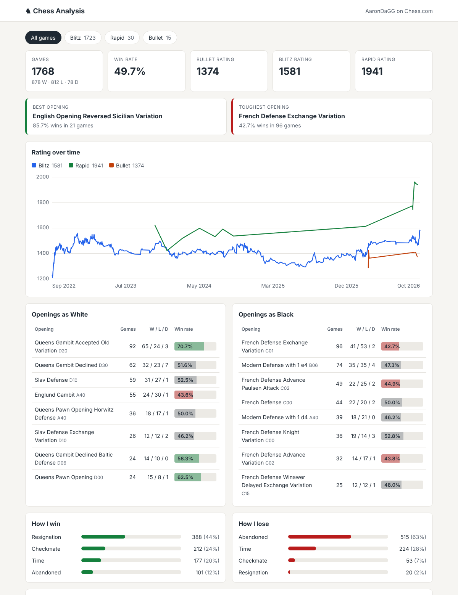

# Chess Analysis

A Django web app that imports my Chess.com games and shows where I win, where I lose, and why: my most common openings, how each one goes for me, and (with Stockfish) the moves where games slip away.

**Live site: [chess-analysis-inky.vercel.app](https://chess-analysis-inky.vercel.app/)** · Stats API: [`/api/stats/`](https://chess-analysis-inky.vercel.app/api/stats/)

> Work in progress. Built in stages; this README grows with each one.



## Plan

**Phase 1: Django core**
- [x] Project setup and `Game` model, with tests running on every push
- [x] Import games from the Chess.com public API (only new games each run)
- [x] Dashboard: most common openings and win rate for each, results as White vs. Black, rating over time
- [x] REST API endpoint for the stats (`/api/stats/`)
- [x] Deploy live on Vercel with a Neon Postgres database and a daily import

**Phase 2: Stockfish analysis**
- [ ] Analyze each game once with Stockfish and store every move's evaluation
- [ ] Flag blunders and mistakes, and show which openings and game phases they come from

## How it's built

- **Django** for the database models, pages, and admin
- **Chess.com's public API** for game data
- **python-chess** to read games (PGN) and talk to Stockfish
- **Postgres on Neon** in production, **SQLite** locally
- **Vercel** for hosting, with a daily **Vercel Cron** import
- **Server-rendered SVG** for the rating chart, so the page needs no JavaScript chart library
- **GitHub Actions** runs the test suite on every push

Each game is stored once, keyed by its platform and game ID, so re-running the importer only adds new games. Stockfish analysis will work the same way: each game is analyzed once and the results are saved, so pages never wait on the engine.

## How new games get in

Three ways, all sharing one importer that only saves games it hasn't seen:

- **Every deploy:** `build.py` applies migrations and imports new games before the site goes live.
- **Daily:** Vercel Cron calls `/cron/import/`, protected by a shared secret.
- **On demand:** the **Refresh games** button (limited to once every 5 minutes).

## API

`GET /api/stats/` returns the dashboard's stats as JSON: overall record, openings as White and Black, best and toughest openings, how games end, ratings, and rating history. Add `?speed=blitz` (or `bullet`, `rapid`, `daily`) to filter.

## Deploying on Vercel

1. Import the repo into Vercel and add a Neon Postgres database from the Storage tab (this sets `DATABASE_URL`).
2. Add environment variables: `DJANGO_SECRET_KEY`, `DJANGO_DEBUG=false`, `DJANGO_ALLOWED_HOSTS=.vercel.app`, `CHESSCOM_USERNAME`, and `CRON_SECRET`.
3. Deploy. The first build imports the full game history.

## Running locally

Requires Python 3.10+.

```bash
python -m venv .venv
source .venv/bin/activate        # Windows: .venv\Scripts\activate
pip install -r requirements.txt

python manage.py migrate
python manage.py createsuperuser  # to log in to the admin
python manage.py runserver
```

Import your games, then open http://127.0.0.1:8000/admin:

```bash
python manage.py import_games <chess.com username>
```

The first run imports every game; later runs only fetch new ones.

To load a saved snapshot of real games instead (from the `data` branch):

```bash
git fetch origin data
git show origin/data:games.json > games.json
python manage.py loaddata games.json
```

Run the tests with:

```bash
python manage.py test
```
